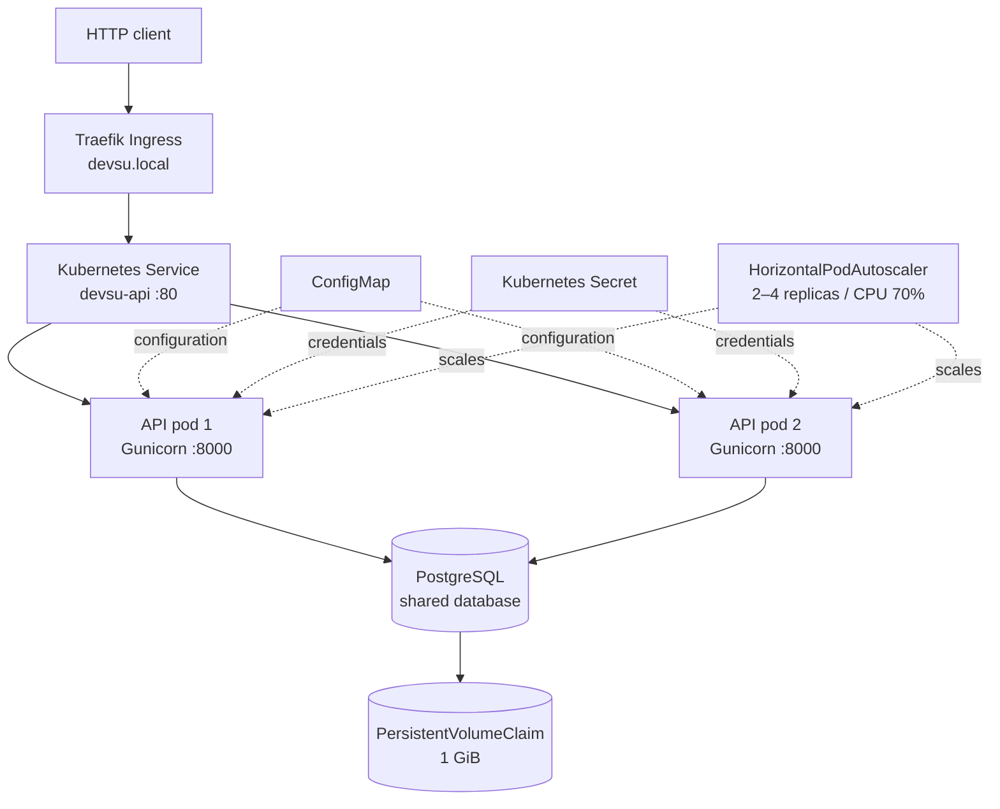
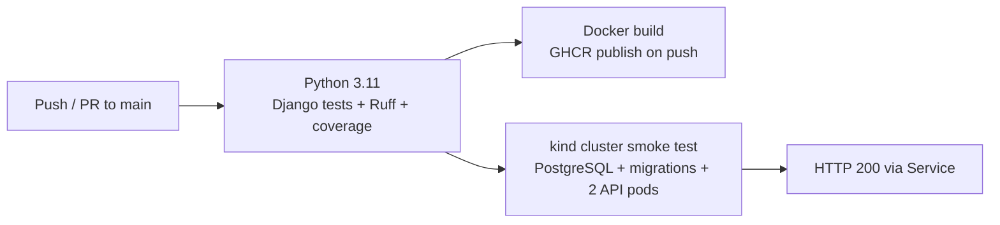

# Devsu DevOps Technical Assessment — Django REST API

[](https://github.com/PedroJoseTrueba/devsu-demo-devops-python/actions)

DevOps implementation of the **Devsu Python starter application**, a small Django REST Framework API for managing users. The assessment adds containerization, automated checks and image publishing, and a Kubernetes deployment with a shared PostgreSQL database.

> **Scope:** The local deployment uses Colima/K3s. GitHub Actions creates a **temporary** Kubernetes cluster (`kind`) for deployment smoke tests; it does **not** deploy to a public production cluster. No public endpoint, external DNS, TLS certificate, or cloud Terraform infrastructure is claimed.

## Architecture



### Continuous integration and delivery



The smoke-test job builds and loads the same application's Dockerfile as an image tagged `devsu-demo-python:ci` into its ephemeral cluster. The CI job validates the Ingress resource but does not install a Traefik controller in `kind`; **Ingress routing was tested separately on local K3s**. Publication to GHCR is a separate pipeline job.

## Project layout

```text
.
├── .github/workflows/ci.yml   # Tests, analysis, image publication, kind smoke test
├── api/                       # Django REST API and unit tests
├── demo/                      # Django configuration, WSGI/ASGI
├── k8s/
│   ├── 00-namespace.yaml      # Namespace: devsu
│   ├── 01-configmap.yaml      # Non-sensitive application settings
│   ├── 02-postgres.yaml       # PostgreSQL, PVC and Service
│   ├── 03-api.yaml            # Django Deployment, 2 replicas, probes
│   ├── 04-service.yaml        # API ClusterIP Service
│   ├── 05-ingress.yaml        # Traefik route: devsu.local
│   ├── 06-hpa.yaml            # CPU-based autoscaling (2–4 replicas)
│   └── 07-migrate-job.yaml    # One-off Django migrations
├── scripts/collect-evidence.sh
├── Dockerfile
├── requirements.txt
├── requirements.docker.txt
└── manage.py
```

## Runtime and design choices

| Area | Choice | Rationale |
| --- | --- | --- |
| Application | Django 4.2 and Django REST Framework | Preserve the provided starter application |
| Container | Python 3.11 slim, Gunicorn, non-root `app` user | Leaner runtime and least-privilege execution |
| Container health | Docker `HEALTHCHECK` against `/api/` | Detect failed HTTP responses |
| Kubernetes probes | HTTP readiness and liveness against `/api/` | Avoid sending traffic to an unhealthy API pod |
| Database | SQLite for local development/tests; PostgreSQL in K8s | A shared datastore is required for multiple replicas |
| Persistence | 1 GiB PVC for PostgreSQL | Retain DB contents across PostgreSQL pod recreation |
| Configuration | ConfigMap + Kubernetes Secret | Separate ordinary configuration from credentials |
| Scaling | HPA, 2 min / 4 max, CPU target 70% | Demonstrate autoscaling configuration using Metrics Server |
| CI/CD | GitHub Actions + GHCR + kind | Reproducible validation without public infrastructure |

## Quick start — Docker (local SQLite)

Requirements: Docker Engine (Colima is suitable for older Intel Macs).

```bash
docker build -t devsu-demo-python:latest .
export DJANGO_SECRET_KEY="$(python3 -c 'import secrets; print(secrets.token_urlsafe(50))')"
docker run -d --name devsu-demo -p 8000:8000 \
  -v devsu_data:/app/data \
  -e DJANGO_SECRET_KEY="$DJANGO_SECRET_KEY" \
  devsu-demo-python:latest

docker exec devsu-demo python manage.py migrate
docker exec devsu-demo python manage.py test
curl -i http://localhost:8000/api/users/
```

The API should respond with HTTP `200` and `[]` before users are added. If a container named `devsu-demo` already exists, reuse it or stop/remove the old **container** (without deleting its named volume) before running another container with that name.

## Deploy to local Kubernetes (K3s on Colima)

Prerequisites: a working Kubernetes cluster (`kubectl get nodes` shows `Ready`), Metrics Server for HPA, and a local Docker image tagged `devsu-demo-python:latest`. On Colima, K3s must have the Traefik controller enabled to serve the Ingress. These examples use the existing local cluster.

```bash
# Initial setup (only once per new namespace)
kubectl apply -f k8s/00-namespace.yaml
kubectl apply -f k8s/01-configmap.yaml
kubectl -n devsu create secret generic devsu-secrets \
  --from-literal=DJANGO_SECRET_KEY="$(python3 -c 'import secrets; print(secrets.token_urlsafe(48))')" \
  --from-literal=POSTGRES_PASSWORD="$(python3 -c 'import secrets; print(secrets.token_urlsafe(24))')"

# Database and schema
kubectl apply -f k8s/02-postgres.yaml
kubectl -n devsu rollout status deployment/postgres --timeout=180s
kubectl apply -f k8s/07-migrate-job.yaml
kubectl -n devsu wait --for=condition=complete job/db-migrate --timeout=180s

# API, routing and autoscaling
kubectl apply -f k8s/03-api.yaml -f k8s/04-service.yaml \
  -f k8s/05-ingress.yaml -f k8s/06-hpa.yaml
kubectl -n devsu rollout status deployment/devsu-api --timeout=180s
kubectl -n devsu get deployments,pods,services,ingress,hpa
```

**Important:** Do not run the `create secret` command again if `devsu-secrets` already exists. Credentials must never be committed to Git or printed in evidence. The one-off migration job is not meant to be re-created by simply applying an already completed job; use a new Job name for future migration executions.

### Verify the API and Ingress

Use terminal A:

```bash
kubectl -n devsu port-forward svc/devsu-api 8080:80
```

Use terminal B:

```bash
curl -i http://localhost:8080/api/users/
```

If Traefik is enabled, use another terminal for:

```bash
kubectl -n kube-system port-forward svc/traefik 8081:80
```

Then test routing through **Traefik** (not just through the API Service):

```bash
curl -i -H 'Host: devsu.local' http://localhost:8081/api/users/
```

A successful deployment responds with HTTP `200` to these requests. `devsu.local` is an internal/demo host, not a public domain; the port-forward is needed here to reach the service from the Mac.

### Autoscaling and resource checks

```bash
kubectl -n devsu get hpa
kubectl -n devsu top pods
kubectl -n devsu get pods -l app=devsu-api
```

The HPA has a minimum of **2**, a maximum of **4**, and a **70% CPU** target. Metrics appearing in the HPA confirms telemetry is available; verifying an actual scale-out would require a controlled load test, which is not claimed here.

## API examples

| Method | Path | Description |
| --- | --- | --- |
| `GET` | `/api/users/` | List users |
| `GET` | `/api/users/{id}/` | Retrieve user |
| `POST` | `/api/users/` | Create user, HTTP `201` on success |

```bash
curl -i -X POST http://localhost:8080/api/users/ \
  -H 'Content-Type: application/json' \
  -d '{"dni":"1234567890","name":"Kubernetes Demo"}'
```

`dni` is unique and accepts up to 13 characters; `name` accepts up to 30 characters. The underlying DRF `ModelViewSet` also provides update/delete operations, although the starter tests focus on create and read.

## CI/CD pipeline

Workflow: [`.github/workflows/ci.yml`](.github/workflows/ci.yml) — [GitHub Actions runs](https://github.com/PedroJoseTrueba/devsu-demo-devops-python/actions).

1. **Tests, lint and coverage:** Python 3.11; bytecode compilation; a targeted set of Ruff checks; Django unit tests; coverage XML artifact (`coverage-report`).
2. **Build and publish image:** Docker Buildx; push to `ghcr.io/pedrojosetrueba/devsu-demo-devops-python:latest` and a commit-SHA tag on pushes to `main` (package visibility/access is controlled by GitHub).
3. **Kubernetes deployment smoke test:** create `kind` cluster; build and load Docker image; start PostgreSQL; run migrations; deploy two Django pods; create Service/Ingress/HPA definitions; verify an HTTP response through the Kubernetes Service.

The pipeline is triggered by push/PR on `main` and manual dispatch. It **does not** continuously update the local Colima cluster or provide a permanently running public endpoint.

## Evidence

Run `bash scripts/collect-evidence.sh` from the repository root after confirming that local Kubernetes is running. The command writes non-secret outputs into `evidence/` for review. Add an image of the successful GitHub Actions execution (all 3 jobs green) to this folder manually, for example `evidence/github-actions-success.png`.

Recommended evidence includes:

- Successful Docker build and Django tests (terminal output or screenshots).
- `kubectl get` outputs showing two ready API pods, PostgreSQL, Ingress and HPA.
- HTTP `200` from API via Kubernetes Service and via Traefik Ingress.
- GitHub Actions successful run with test, image and kind jobs.
- Coverage report from Actions artifacts, if desired.

**Never include** kubeconfig files, `.env`, secret values, GitHub tokens or the PostgreSQL data directory in evidence or the deliverable ZIP.

## Limitations and production improvements

This is a **technical assessment deployment**, not a production-ready system. Explicit gaps and future improvements:

- PostgreSQL is a single instance with one PVC on a single-node local cluster; it is not highly available. Production would use managed PostgreSQL/backup/restore, encryption and appropriate storage classes.
- `devsu.local` has no external DNS or TLS certificate, and no publicly reachable endpoint is provided. Production needs DNS, TLS via cert-manager or provider integration, and secure ingress configuration.
- The HPA has live metrics but no demonstrated scale-out under load; add a load test and document scaling response.
- CI validates a temporary Kubernetes deployment using a locally built CI image; for real CD, deploy an immutable published SHA image to a persistent cluster using protected credentials/identities and rollout safeguards.
- Add a dependency/security vulnerability scan and stronger lint rules; assess framework/package upgrades and production Django security settings before internet exposure.
- Add centralized logs, observability, alerting, database backups and resource/availability monitoring for production operations.
- Cloud IaC with Terraform/CloudFormation is **not implemented**; this was listed as extra credit in the task.

## Attribution

The base Django application was supplied as Devsu's technical assessment starter project. Containerization, GitHub Actions workflow, Kubernetes configurations and deployment documentation were developed for this assessment. Original starter README: copyright © 2023 Devsu, all rights reserved.
